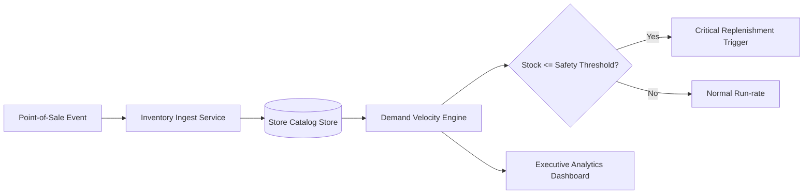

# Retail Inventory & Demand Analytics Hub 🛒📊

[](https://github.com/hemanthgulivindala3-prog/retail-inventory-analytics-hub)
[](https://www.typescriptlang.org/)
[](https://nodejs.org/)
[](https://opensource.org/licenses/MIT)

An enterprise multi-store retail supply chain tracking and inventory replenishment system modeled after large Canadian retail operations.

---

## 🏬 Core Capabilities
- **Multi-Store Catalog Architecture**: SKU-level tracking across Automotive, Hardware, Sports, and Seasonal departments.
- **Stock Depletion Forecasting**: Days-of-Inventory (DOI) remaining calculations based on rolling daily run-rate velocity.
- **Critical Restock Threshold Triggers**: Automated alerts when shelf stock hits safety thresholds.
- **Executive Operations Dashboard**: Clean KPI widgets tracking active valuation, category breakdown, and reorder triggers.



---

## 🚀 Quick Start
```bash
cd apps/api
npm install
npm run dev
```

## 📄 License
MIT © [Hemanth Gulivindula](https://github.com/hemanthgulivindala3-prog)
